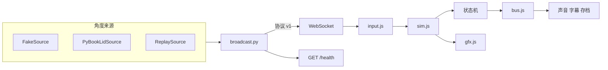

# 结构

网页不读传感器，桥不画场景。玩法判定不碰网格，网格不决定「这一拍发生了什么」。

## 网页

| 模块 | 职责 |
|---|---|
| `frontend/js/play-machine.js` | 摇晃、猛开、停住、一整天、合盖。改 `S` 上的字段，发出事件 |
| `frontend/js/kitten-machine.js` | 小猫这一拍是 `hidden` / `nap` / `dawn` / `play` |
| `frontend/js/season-machine.js` | 打开过程中的换季进度 |
| `frontend/js/season-beats.js` | 春、冬的两句季节反应，不是秘密 |
| `frontend/js/season-ritual.js` `sky-bands.js` | 换季锋面曲线、每季动机、天空时段权重。不引用 Three |
| `frontend/js/season-sweep.js` `sky-gradient.js` `season-light.js` `season-motif.js` | 扫场粒子、天空渐变、光色、现场合成的短动机 |
| `frontend/js/bus.js` | 同步事件总线 |
| `frontend/js/play-wire.js` | 订阅事件，调用声音、字幕、`discover` |
| `frontend/js/sim-*.js` | 弹簧、网格、灯光。问状态机，不自己写判定 |
| `frontend/js/quality.js` | 隐藏页面不画；像素比和阴影贴图只降不升 |
| `frontend/js/tuning.js` | 手感数字，唯一的一处 |

`S` 仍是运行时状态，`__popup.dbg()` 读的是同一份。状态机没有自己藏一份平行状态。

## 桥

`bridge.py` 只解析参数并选一个适配器。读角度、序号、心跳、`/health` 在 `broadcast.py` 和 `health.py`。适配器契约在 `docs/ADAPTERS.md`。线上的帧格式仍是 `docs/PROTOCOL.md` 的 v1。
