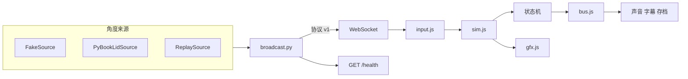

# 结构

网页不读传感器，桥不画场景。玩法判定不碰网格，网格不决定「这一拍发生了什么」。

## 网页

| 模块 | 职责 |
|---|---|
| `frontend/js/play-machine.js` | 摇晃、猛开、停住、一整天、合盖。改 `S` 上的字段，发出事件 |
| `frontend/js/kitten-machine.js` | 小猫这一拍是 `hidden` / `nap` / `dawn` / `play` |
| `frontend/js/kitten-mood.js` | 记性带来的心情、打盹和叫醒、不循环的闲置动作。状态在 `S.kittenMood` |
| `frontend/js/kitten-look.js` | 把心情画在眼睛和耳朵上，不改根节点位置 |
| `frontend/js/eye-read.js` | 低盖角时把小猫和缝里的眼睛略放大、朝相机偏一点，并加一圈淡轮廓。不改心情、合页和开场 |
| `frontend/js/season-machine.js` | 打开过程中的换季进度 |
| `frontend/js/season-beats.js` | 春、冬的两句季节反应，不是秘密 |
| `frontend/js/season-ritual.js` `sky-bands.js` | 换季锋面曲线、每季动机、天空时段权重。不引用 Three |
| `frontend/js/season-sweep.js` `sky-gradient.js` `season-light.js` `season-motif.js` | 扫场粒子、天空渐变、光色、现场合成的短动机 |
| `frontend/js/ambient-light.js` | 可选的房间勒克斯 → 已有的白天 / 黄昏 / 夜。滞回在 `TUNING.ambient`。合页仍决定角度、日晷和秘密 |
| `frontend/js/bus.js` | 同步事件总线 |
| `frontend/js/play-wire.js` | 订阅事件，调用声音、字幕、`discover` |
| `frontend/js/journal-hints.js` | 贴纸本的靠近、提示等级。不触发秘密 |
| `frontend/js/journal-watch.js` `journal-book.js` `sticker-art.js` | 每帧记进度；八格贴纸和集齐画面 |
| `frontend/js/sim-*.js` | 弹簧、网格、灯光。问状态机，不自己写判定 |
| `frontend/js/quality.js` | 隐藏页面不画；像素比和阴影贴图只降不升 |
| `frontend/js/tuning.js` | 手感数字，唯一的一处。分享卡在 `SHARE`，合页拟音和镜头在 `HINGE_FEEL`，开场在 `stage*`，换季仪式在 `ritual*`，贴纸本在 `sticker*`，小猫心情在 `kitten`，低盖角眼睛在 `eyeRead*`，环境光滞回在 `ambient`，轻拍在 `tap*`，触控板逗猫在 `trackpad`，窗台礼物在 `trackWeight` |
| `frontend/js/kitten-memory.js` `kitten-lines.js` `kitten-wire.js` | 见面记录、闲话、把心情接到存档 |
| `frontend/js/share-layout.js` | 分享卡文案和排版。纯函数 |
| `frontend/js/share-border.js` | 手绘边和纸边墨点。纯函数 |
| `frontend/js/share-draw.js` | 把排版画到画布 |
| `frontend/js/share-capture.js` | 读 WebGL、下载、剪贴板、短片 |
| `frontend/js/share-wire.js` | 按钮和 `C`。没在录的时候不读像素 |
| `frontend/js/hinge-feel.js` | 角速度 → 嘎吱、纸声、轻撞、镜头偏移。纯函数 |
| `frontend/js/hinge-audio.js` | 把上面的数字放进 WebAudio，接到主音量 |
| `frontend/js/track-weight.js` | 可选力度 → 窗台礼物、闻一下、拿开复原。纯函数，不读角度 |
| `frontend/js/track-weight-view.js` | 礼物纸盒和嗅探姿态。不画秤 |
| `frontend/js/track-weight-wire.js` | 把样本接到状态机。字段缺着就当没有通道 |
| `frontend/js/sim-feel.js` | 套到相机上，并在静音时把拟音让掉 |
| `frontend/js/stage-show.js` | 开场幕布。角度 → 暗角、扫光、分层折纸。不判秘密 |
| `frontend/js/stage-show-view.js` | 把幕布画到暗角和纸片上 |
| `frontend/js/tap-machine.js` `tap-accent.js` | 轻拍 / 连敲。kind + strength 进，冷却、补播和开场幕布在这里挡掉。花瓣点缀的位置也在这里，不读换季进度 |
| `frontend/js/tap-petals.js` `tap-wire.js` | 舱门前一小团花瓣（自己的实例，不碰换季扫场）；声音、害羞和揭贴纸在订阅端 |
| `frontend/js/trackpad-pet.js` | 光标粘住、滚动是否还跟手、轻压眯眼。纯函数。没有旋钮和音量 |
| `frontend/js/trackpad-haptic.js` | 把一次固定的触控板轻点编成发给桥的文本 |
| `frontend/js/trackpad-wire.js` | 投影热点、字幕和呼噜、贴纸揭开 / 换季落地时请桥轻点。桥做不到就跳过 |

`S` 仍是运行时状态，`__popup.dbg()` 读的是同一份。状态机没有自己藏一份平行状态。

## 桥

`bridge.py` 只解析参数并选一个适配器。读角度、序号、心跳、轻拍、`/health` 在 `broadcast.py` 和 `health.py`。适配器契约在 `docs/ADAPTERS.md`。角度帧仍是 `docs/PROTOCOL.md` 的 v1。可选 `light` 和 `weight` 不参与开合；轻拍是同一版本上另加的 `tap` 帧，只带 `kind` 和 `strength`。网页可以另请桥做一下触控板轻点；`haptic.py` 做不到就当没这回事，不改角度。

Force Touch 不是又一种角度来源。`broadcast.py` 在角度帧上附加可选的 `weight`。设备不在或子进程退出时省略该字段，合页循环照旧。`/health` 仍只有角度。
